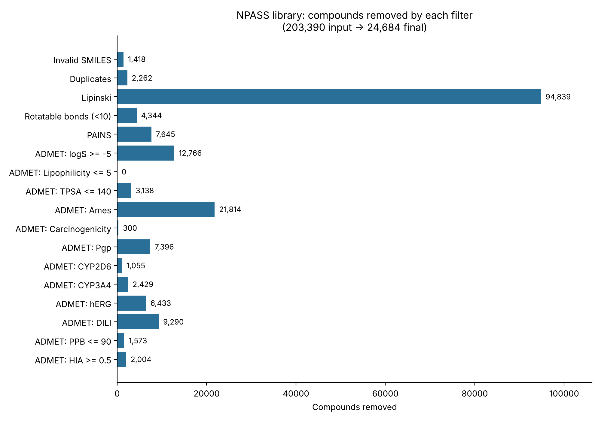
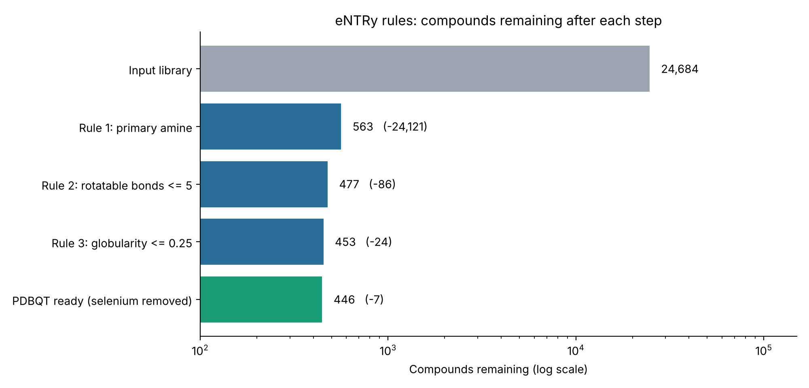

# NPASS Natural Product Filtering

Two sequential scripts applied to the **NPASS** natural product library, to prepare compounds for AI-driven drug discovery and structure-based docking against antimicrobial resistance (AMR) targets. The second script takes the filtered output of the first.

**Status:** library prepared for ongoing MS thesis work (REINVENT4). No results are reported here.

| Script | Purpose | Input | Output |
|---|---|---|---|
| `rdkit_filtering/rdkit_code.py` | General drug-likeness, assay-interference and ADMET filtering | 203,390 compounds | **24,684 compounds** (library for REINVENT4 thesis work) |
| `entry_rules/entry_rules.py` | eNTRy rules for Gram-negative accumulation, then docking-ligand preparation | 24,684 compounds | **446 docking-ready ligands** (PDBQT) |

## Data source

Compounds come from the [NPASS database](https://bidd.group/NPASS/) (Natural Products Activity and Species Source), which lists 204,023 unique natural products. The file used here (`npass_compounds.txt`) was read as **203,390** compounds, and this is the input count used throughout this repository. Version / download date: **ADD VERSION OR DATE HERE**. The raw data is not included in this repository.

---

## 1. RDKit property filtering

`rdkit_filtering/rdkit_code.py` reduces the raw NPASS library to a drug-like, low-risk set. Filters are applied one after the other, in the order shown.



| Step | Filter | Removed | Left |
|---|---|---:|---:|
| 0 | Input library | - | 203,390 |
| 1 | Invalid SMILES | 1,418 | 201,972 |
| 2 | Duplicates (canonical SMILES) | 2,262 | 199,710 |
| 3 | Lipinski rule of five (0 violations allowed) | 94,839 | 104,871 |
| 4 | Rotatable bonds < 10 | 4,344 | 100,527 |
| 5 | PAINS (A + B + C) | 7,645 | 92,882 |
| 6 | ADMET: logS >= -5 | 12,766 | 80,116 |
| 7 | ADMET: Lipophilicity <= 5 | 0 | 80,116 |
| 8 | ADMET: TPSA <= 140 | 3,138 | 76,978 |
| 9 | ADMET: Ames <= 0.5 | 21,814 | 55,164 |
| 10 | ADMET: Carcinogenicity <= 0.5 | 300 | 54,864 |
| 11 | ADMET: Pgp <= 0.5 | 7,396 | 47,468 |
| 12 | ADMET: CYP2D6 inhibition <= 0.5 | 1,055 | 46,413 |
| 13 | ADMET: CYP3A4 inhibition <= 0.5 | 2,429 | 43,984 |
| 14 | ADMET: hERG <= 0.5 | 6,433 | 37,551 |
| 15 | ADMET: DILI <= 0.5 | 9,290 | 28,261 |
| 16 | ADMET: PPB <= 90 | 1,573 | 26,688 |
| 17 | ADMET: HIA >= 0.5 (good absorption) | 2,004 | **24,684** |

Notes:
- The Lipinski step removes the most compounds. Individual rule breaks: MW 66,099, LogP 41,348, HBD 37,092, HBA 39,679 (a compound can break more than one rule).
- The ADMET lipophilicity filter removed 0 compounds: no remaining compound exceeded the cut-off.
- ADMET values are model predictions from [ADMET-AI](https://github.com/swansonk14/admet_ai), not experimental measurements.

Full log: [`rdkit_filtering/rdkit_filtering_summary.txt`](rdkit_filtering/rdkit_filtering_summary.txt)

---

## 2. eNTRy rules and ligand preparation

`entry_rules/entry_rules.py` takes the 24,684 filtered compounds and selects those likely to accumulate in Gram-negative bacteria, following the eNTRy rules (Richter et al., *Nature* 2017):

1. **Rule 1:** contains a primary amine on an sp3 carbon (amides, anilines, sulfonamides, hydrazines and hydroxylamines excluded)
2. **Rule 2:** rigidity, rotatable bonds <= 5
3. **Rule 3:** low three-dimensionality, globularity <= 0.25 (calculated from an ETKDGv3 3D structure, MMFF-optimised)

Passing compounds are then converted to 3D SDF files and PDBQT files (Meeko) for docking with AutoDock Vina, Smina or GNINA.



| Step | Removed | Left |
|---|---:|---:|
| Input library | - | 24,684 |
| Rule 1: primary amine | 24,121 | 563 |
| Rule 2: rotatable bonds <= 5 | 86 | 477 |
| Rule 3: globularity <= 0.25 | 24 | 453 |
| PDBQT conversion (selenium compounds skipped) | 7 | **446** |

Notes:
- Steps are shown one after the other. Applied alone to all 24,684 compounds, Rule 2 would keep 21,749.
- Globularity could not be calculated for 3 of the 477 compounds, which are therefore counted in Rule 3's removals.
- 453 compounds passed all three rules. 7 selenium-containing compounds were then skipped because AutoDock Vina has no atom type for selenium, leaving **446** docking-ready ligands.

Full log: [`entry_rules/entry_rules_summary.txt`](entry_rules/entry_rules_summary.txt)

---

## Limitations

- **ADMET filters are model predictions** and assume oral drug-likeness. They are not experimental measurements and may not suit every antibacterial use case.
- **Filters were applied sequentially**, so the counts removed at each step depend on the order. For example, the hERG and P-gp filters may remove basic amine compounds disproportionately, which could shrink the pool available to the eNTRy primary-amine rule.
- **The eNTRy rules come from a limited set of compounds**, mainly tested in *E. coli*. They are a prioritisation heuristic, not a guarantee of accumulation in other Gram-negative species such as *A. baumannii*.

## Reproducibility

- 3D structure generation (RDKit ETKDGv3, used for globularity and for docking ligands) uses a fixed random seed of 42.
- Package versions are pinned in `requirements.txt`.
- Both scripts print and save a summary log of the counts at every step (see the `.txt` files above).

## Repository structure

```
npass-filtering/
├── README.md
├── LICENSE
├── requirements.txt
├── rdkit_filtering/
│   ├── rdkit_code.py
│   ├── rdkit_filtering_summary.txt
│   └── filter_removal_chart.png
└── entry_rules/
    ├── entry_rules.py
    ├── entry_rules_summary.txt
    └── entry_rules_funnel_chart.png
```

## Usage

Both scripts were written for **Google Colab** with data stored on Google Drive.

1. Obtain the NPASS compound file from the [NPASS database](https://bidd.group/NPASS/) and place it in your Drive.
2. Edit the file paths at the top of each script (input file, output folder).
3. Run `rdkit_code.py`, then run `entry_rules.py` on its filtered output.
4. Install the dependencies if needed: `pip install -r requirements.txt`

Large output files (CSV, SDF, PDBQT) are not included in this repository.

## Configurable settings

| Setting | Script | Default |
|---|---|---|
| Lipinski cut-offs (MW, LogP, HBD, HBA) | `rdkit_code.py` | 500, 5, 5, 10 |
| Lipinski violations allowed | `rdkit_code.py` | 0 |
| Maximum rotatable bonds | `rdkit_code.py` | < 10 |
| ADMET cut-offs | `rdkit_code.py` | see `admet_filters` list |
| Rotatable bonds (eNTRy) | `entry_rules.py` | <= 5 |
| Globularity (eNTRy) | `entry_rules.py` | <= 0.25 |

## Tools

RDKit, ADMET-AI, Meeko, pandas, NumPy, tqdm, Google Colab

## Reference

Richter, M. F. et al. Predictive compound accumulation rules yield a broad-spectrum antibiotic. *Nature* 545, 299-304 (2017).

## License

MIT, see [LICENSE](LICENSE).

## Author

[abmateen612](https://github.com/abmateen612)
